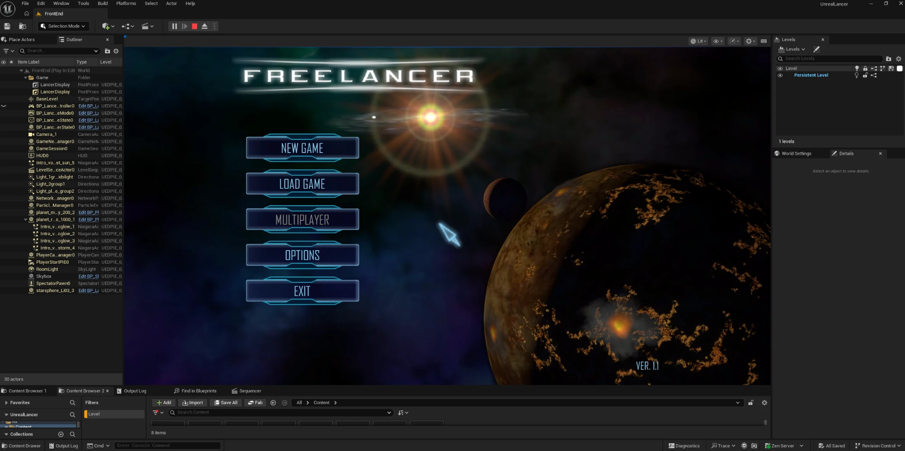

# Unreal Lancer

Unreal Lancer is a toolkit that converts your own copy of Freelancer (2003) into a native Unreal Engine 5
project.

The goal is the same game on a modern engine. Freelancer's simplicity is part of its appeal, so the
toolkit keeps the game as it is and does not redesign it.

## Screenshots

*The main menu, converted from the game's own files and running in the Unreal Engine 5 editor.*

## How it works

1. The converters turn the game's models, textures, sounds, star systems and cutscenes into Unreal assets.
2. The game's mechanics are rebuilt with Unreal's own systems: Blueprints, UMG, State Trees and Sequencer.
3. You get an Unreal project on your own machine. Nothing from the original engine runs.

## What it is not

- **Not a copy of the game.** This repo holds no game files. You need your own copy of Freelancer.
- **Not a reimagining.** No new features for their own sake.
- **Not a port.** It is a set of scripts that do the conversion locally.

---

Freelancer is a trademark of Microsoft. Unreal Lancer is a fan project. It is not affiliated with or
endorsed by Microsoft or Digital Anvil, and it ships no game content.
